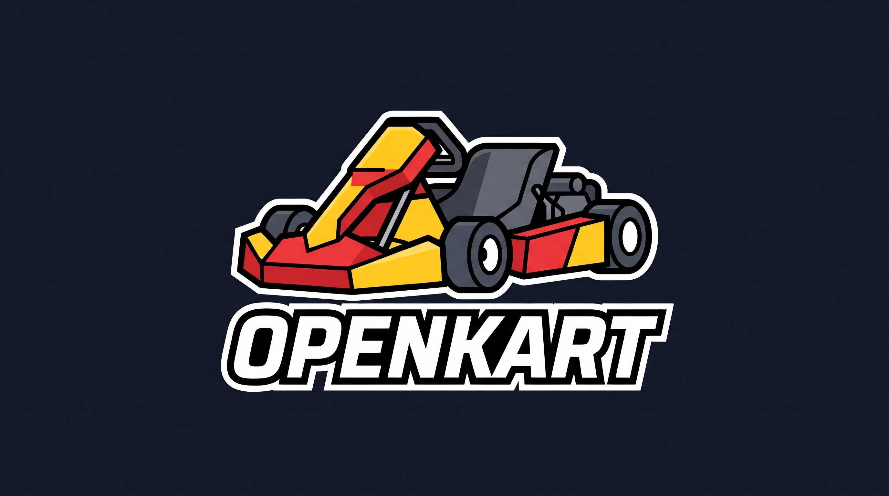

# OpenKart
- https://www.roblox.com/games/90228466903424/OpenKart
**Unofficial port of [SuperTuxKart](https://supertuxkart.net/) (`1.5`) to Roblox.**

- **Upstream source:** https://github.com/supertuxkart/stk-code (pinned tag `1.5`, commit `1fb491f507216c5d181ccd85f29ff08eca003827`)
- **Upstream assets:** `https://svn.code.sf.net/p/supertuxkart/code/stk-assets` (pinned SVN revision `18627`)
- **License:** GNU General Public License v3.0 or later ([LICENSE](LICENSE)) for all OpenKart source code; imported/converted media carries per-file Creative Commons / open licenses tracked in [assets/CREDITS.md](assets/CREDITS.md).
- **Trademark notice:** `"SuperTuxKart"` trademark permission is currently **PENDING** ([docs/upstream.md](docs/upstream.md)). **`OpenKart`** is the fallback title until upstream permission is granted.

---

## Repository Layout

- `src/` — Luau source (`shared/`, `server/`, `client/`) synced via Rojo
- `tests/` — Headless Lune test suite (`tests/run.luau`)
- `tools/stk2rbx/` — Offline Python 3 converter for STK XML tracks, drivelines, checkpoints, and `.spm`/`.b3d` mesh audits
- `assets/` — Converted Roblox models (`assets/roblox/`) and per-file license ledger ([assets/CREDITS.md](assets/CREDITS.md))
- `docs/` — Engineering specs ([physics-spec.md](docs/physics-spec.md)), [port-map.md](docs/port-map.md), [upstream.md](docs/upstream.md), [decisions.md](docs/decisions.md), [divergences.md](docs/divergences.md)

---

## Corresponding Source Build Prerequisites

To build and verify the complete place file from a fresh clone:

1. **Rokit toolchain** (`rokit.toml`): `rojo 7.7.1`, `wally 0.3.2`, `stylua 2.6.0`, `selene 0.32.0`, `luau-lsp 1.70.1`, `lune 0.11.1`.
2. **Roblox Luau type definitions** (`types/globalTypes.d.luau`, checked into the repo from `https://luau-lsp.pages.dev/type-definitions/globalTypes.None.d.luau`). Required for `luau-lsp analyze`; a missing definitions file is a hard verification failure.
3. **Python 3.10+** (standard library only — runs `tools/stk2rbx`).
4. **SVN** (or `python -m tools.stk2rbx fetch` over HTTPS) + out-of-repo checkouts:
   - `stk-code` tag `1.5` at `C:\dev\stk-code`
   - `stk-assets` revision `18627` at `C:\dev\stk-assets` (see [docs/upstream.md](docs/upstream.md))

---

## Development & Verification Commands

Convert the Month 1 spike track (`sandtrack`) and build the place file:

```powershell
python -m tools.stk2rbx convert C:\dev\stk-assets\tracks\sandtrack --out assets/roblox/tracks/sandtrack.model.json --report build/sandtrack-report.json
rojo sourcemap default.project.json --output sourcemap.json
rojo build default.project.json -o openkart-dev.rbxl
```

Live Studio workflow:
- Run `rojo serve default.project.json` and connect via the Rojo Studio plugin. **Restart `rojo serve` and reconnect** whenever `default.project.json` changes; never hand-edit `.rbxl`.

Run all automated checks before committing (confirm `types/globalTypes.d.luau` loads cleanly with zero definitions errors):

```powershell
python -m unittest discover -s tools/stk2rbx -v
stylua --check src/ tests/
selene src/ tests/
luau-lsp analyze --definitions=@roblox=types/globalTypes.d.luau --sourcemap sourcemap.json src/
lune run tests/run.luau
```
