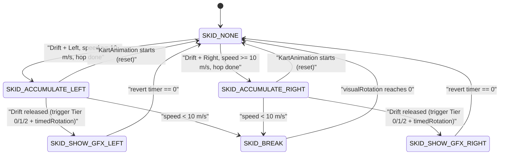

# Implementation Plan: `docs/physics-spec.md` (Raycast Kart Physics Specification)

## Goal Description

Author [docs/physics-spec.md](physics-spec.md) as the complete, authoritative engineering specification for OpenKart's custom Luau raycast kart physics solver (`src/shared/physics/KartSolver.lua`, `src/shared/kart/Skidding.lua`, `src/shared/kart/MaxSpeed.lua`, `src/shared/KartTuning.lua`).

Per `AGENTS.md`, Bullet's raycast vehicle (`lib/bullet` + `src/physics/btKart.cpp`) cannot run on Roblox and is an accepted divergence, while kart behavior, feel, and constants must faithfully reproduce pinned upstream **SuperTuxKart `1.5`** (`C:\dev\stk-code`, commit `1fb491f507216c5d181ccd85f29ff08eca003827`). This specification must directly support the **Month 1** kart physics skeleton and the **Month 2 GO/NO-GO gate** ("does drift feel good") with zero magic numbers and quantitative, testable handling targets.

---

## User Review Required

> [!IMPORTANT]
> Auditing STK `1.5`'s actual physics code revealed three upstream quirks that directly shape how we specify the Roblox solver:
> 1. **STK `1.5` runs physics at `120 Hz`** (`data/stk_config.xml:L147`) and stores timers (skid charge, timed knockback impulse, post-skid rotation, brake ramp, nitro) as integer 120 Hz ticks.
> 2. **STK `1.5` disables Bullet tire slip on flat ground** (`<friction slip="10000000"/>`, `data/stk_config.xml:L435`). Normal cornering tracks a speed-indexed turn-radius table `R(v)` with bilateral zero-slip impulses; drifting works via locked steering remap `[0.2, 0.8]` + visual chassis yaw (`visual="1.25"`) + post-skid `setTimedRotation`, while Bullet tire slip only turns on during **knockback** (`skidInfo = 0`) and **steep slopes** (`dot(n, up) < 0.90`).
> 3. **STK `1.5` applies substantial hidden extra gravity while airborne** (`btKart.cpp:L595-L611`): each off-ground wheel adds `-trackConnectionAccel * mass` (`-2 m/s²` per wheel = `-8 m/s²` with 4 wheels off ground), making effective airborne gravity `9.80665 + 8.0 = 17.80665 m/s²` (`63.6 studs/s²`), and `Kart::applyEngineForce` (`kart.cpp:L3084-L3095`) applies `0.4×` to each front wheel and `0.6×` to each rear wheel (`2.0×` total force across 4 wheels).

---

## Open Questions

Please confirm your preferences on the four design choices below before I write `docs/physics-spec.md`:

> [!WARNING]
> **Q1 — Fixed Timestep Rate (`120 Hz` vs `60 Hz`)**
> - **Option A (Recommended): `120 Hz` (`dt = 1/120 s`)** — matches STK `1.5` 1:1 (`stk_config.xml:L147`), runs 2 fixed substeps per 60 Hz Roblox `Heartbeat`, preserves STK integer tick counts and spring stability (`stiffness = 280`).
> - **Option B: `60 Hz` (`dt = 1/60 s`)** — halves server raycast load at 20 players (4,800 vs 9,600 raycasts/s), but requires verifying suspension spring stability (`stiffness = 280`, `damping = 35`) at larger `dt` and scaling tick-based constants.

> [!WARNING]
> **Q2 — Slip-Angle → Grip Curve & Drift Lateral Model**
> - **Option A (Recommended): Parameterized Slip-Angle Curve + STK-Faithful Drift Model** — use a smooth piecewise/Pacejka-lite slip-angle → lateral grip curve (`α → μ(α)`) to replace Bullet's bilateral constraint without low-speed jitter, tuned to high cornering stiffness in normal driving so steady-state turn radii match STK's `R(v)` table; keep STK's exact `Skidding` state machine (steering remap `[0.2, 0.8]`, visual chassis yaw up to `1.0 rad`, post-skid `setTimedRotation`), plus a tunable `driftRearGripScale` parameter (default `1.0` for pure STK fidelity, adjustable `< 1.0` during Month 2 playtests).
> - **Option B: Physical Rear-Slip Drift** — reduce rear-axle peak grip during drift so the physical chassis genuinely oversteers to a target slip angle without visual-only yaw / `setTimedRotation` (requires an entry in `docs/divergences.md`).

> [!NOTE]
> **Q3 — Internal Solver Units (SI Meters vs Roblox Studs)**
> - **Option A (Recommended): SI Meters Inside Solver** — run all forces, masses (`kg`), velocities (`m/s`), and wheel geometry (`m`) internally in SI meters so every upstream STK formula and `KartTuning.lua` constant stays directly comparable to `C:\dev\stk-code`, converting at the Roblox `Workspace:Raycast` / `CFrame` boundary via `src/shared/Units.lua` (`1 stud = 0.28 m`) and flipping `+Z` ↔ `-Z` forward.
> - **Option B: Native Roblox Studs Inside Solver** — convert all constants up front into studs, studs/s, studs/s².

> [!NOTE]
> **Q4 — Rigid-Body Integration Backing (Pure-Luau Integrator vs Roblox `BasePart` Forces)**
> - **Option A (Recommended): Deterministic Pure-Luau Rigid-Body Integrator** — solver owns chassis `(position, orientation, linearVel, angularVel)`, integrates semi-implicit Euler per fixed tick, uses an injected raycast/sweep interface (Roblox `Workspace:Raycast` / `Blockcast` in Studio, analytic flat/ramp/wall surfaces in Lune tests), and writes the interpolated `CFrame` to an anchored visual/collider model. Makes client prediction, server reconciliation, and headless `lune run tests/run.luau` testing 100% deterministic.
> - **Option B: Roblox Dynamic `BasePart` with `VectorForce` / `ApplyImpulse`** — leverages Roblox's built-in rigid-body collision solver, but makes deterministic rewind/reconciliation and headless Lune testing significantly harder.

---

## Proposed Changes

Only documentation is created in this task (`No code` — no `.lua` / `.luau` edits). Once approved, I will create `docs/physics-spec.md` with the structure detailed below.

---

### Physics Specification Document

#### [NEW] [physics-spec.md](physics-spec.md)

The document will contain eight tightly scoped technical sections:

#### 1. Architecture, Coordinate Conventions & Fixed Timestep
- **Coordinate mapping:** STK (`+X` right, `+Y` up, `+Z` forward, SI meters) ↔ Roblox (`+X` right, `+Y` up, `-Z` forward, `1 stud = 0.28 m` per [Units.lua](../src/shared/Units.lua)).
- **Fixed timestep accumulator:**
  - Step size `FIXED_DT = 1 / 120` (or `1 / 60` per Q1), `MAX_FRAME_DT = 1 / 15`, `MAX_SUBSTEPS = 8` (spiral-of-death clamp).
  - Integer tick counter (`tick: number`) mirroring STK's `time2Ticks` / `ticks2Time`.
  - Render interpolation factor `alpha = accumulator / FIXED_DT` (`CFrame:Lerp` between `prevTransform` and `currTransform`, plus smoothed visual skid yaw & graphical hop offset).
- **Per-tick execution pipeline** (exact order mirroring `Kart::update` → `Kart::updatePhysics` → `Physics::update` → `btKart::updateVehicle`):
  1. Input smoothing (`PlayerController::steer` ramp/reset rates).
  2. Active kart animation check (rescue / explosion / cannon bypasses normal driving).
  3. Surface & terrain query (center-of-wheels raycast `+0.3 m` along local `+Y`), gravity vector update, zipper/reset/slowdown triggers.
  4. Longitudinal powertrain (`MaxSpeed` update, gear table, nitro, `applyAirFriction`, brake ramp, park brake `< 5 m/s`).
  5. Drift state machine update (`Skidding::update`) → `steeringFraction`, visual yaw, hop timer, charge tier, post-skid `timedRotation`.
  6. Wheel steering angles (`maxSteerAngle(speed) * steeringFraction`) & steep-slope adhesion (`updateSliding`).
  7. 4-wheel raycasts (with `0.95×` inward seam fallback) & grounded wheel count.
  8. Airborne stabilization (`numWheelsOnGround == 0` auto-level torque; `!isOnGround` angular velocity damping & linear damping zeroing).
  9. Suspension spring-damper forces + `trackConnectionAccel` + 4-wheel `downwardImpulseFactor`.
  10. Longitudinal & slip-angle lateral tire impulses (clamped by traction circle, zeroed during active `timedCentralImpulse`).
  11. Active knockback `timedCentralImpulse` + post-skid `timedRotation` + rigid-body integration & chassis-wall/kart collision resolution.
  12. Speed floor/ceiling enforcement (`btKart::adjustSpeed`: `minSpeed` for zippers/boosts, `maxSpeed` when grounded, uncapped in air).

#### 2. 4-Wheel Raycast Suspension & Chassis Geometry
- **Chassis bounds & CoG shift** (`kart.cpp:L663-L735`, `kart_properties.cpp:L363-L377`, `official_karts.xml`):
  - Height cap `h = min(modelHeight, 0.6 * length)`.
  - Bevelled hull (`bevel-factor = (0.5, 0.0, 0.3)`), `wheelBase = length`, CoG shifted down (`gravity-shift.y = h / 2`).
  - Default wheel hardpoints at bottom corners (`x = ±width / 2`, `y = 0` relative to shifted CoG, `z = ±0.5 * length * (1 - bevelZ)`) plus XML defaults `(±0.38, 0, ±0.6)`.
- **Raycast geometry** (`btKart.cpp:L227-L359`):
  - Cast from `hardPointWS` along chassis local `-Y` for `rayLen = rest + travel + 0.5` (`0.3 + 0.29 + 0.5 = 1.09 m`).
  - Contact valid when `hit` AND `depth < rest + travel` (`0.59 m`).
  - Seam-snag mitigation: if ray misses, retry once at `0.95 * connectionPointCS`.
  - Clamp `suspensionLength` to `[rest - travel, rest + travel]` (`[0.01 m, 0.59 m]`).
- **Spring + asymmetric damper law** (`btKart.cpp:L586-L639`):
  - `invDot = -1 / min(dot(contactNormal, wheelDir), -0.1)` (max `10.0`).
  - `lengthDiff = rest - suspensionLength` (optional exponential mode `exp-spring-response = false`).
  - `vRel = dot(contactNormal, vPoint) * invDot`.
  - `damping = (vRel < 0) ? dampingCompression (15) : dampingRelaxation (35)`.
  - `F_susp = clamp((stiffness * lengthDiff * invDot - damping * vRel) * mass, 0, maxForce)` (`stiffness = 280`, `maxForce = 32000 N`).
  - Unloaded wheel pulls with `-trackConnectionAccel * mass` (`-2 * mass`).
  - Roll torque attenuation: `rollInfluence = 0.3` and angular inertia scaling `angularFactor = (0.25, 1.0, 0.5)` (`kart_characteristics.xml:L53,58`).
  - Downforce when all 4 wheels grounded: `-|speed| * downwardImpulseFactor` (`5`) along chassis `-Y`.

#### 3. Longitudinal Powertrain, Steering Geometry & Slip-Angle → Grip Curve
- **Powertrain & Air Drag** (`kart.cpp:L1216-L1235`, `L2738-L2893`, `L3079-L3096`):
  - Gear multiplier lookup (`switch-ratio` / `power-increase`) + `MaxSpeed` additive boost force + nitro multiplier (`1.2×`).
  - `applyAirFriction`: linear-damping compensation `+39.33 * |v| * (m / 350)` minus nonlinear drag `5 * |v|^1.5` (multiplied by `parachuteFriction = 5.0` when parachuted).
  - 4WD torque split: `0.4` per front wheel, `0.6` per rear wheel (`2.0×` total force summed across 4 wheels).
  - Braking ramp (`brakeFactor * (1 + brakeTime * brakeTimeIncrease)`), reverse cap (`maxSpeed * reverseRatio`), parking brake (`20` when `|v| < 5 m/s` and no throttle/brake).
- **Speed-dependent Steering** (`kart.cpp:L912-L924`, `kart_characteristics.xml:L82-L84`):
  - Piecewise-linear `turnRadius(speed)` table → `maxSteerAngle(v) = sin(1 / R(v)) * wheelBase`.
  - Two-zone digital steer ramp (`0..0.5` in `0.17 s`, `0.5..1.0` in `0.28 s`, return-to-center in `0.10 s`).
- **Slip-Angle → Grip Curve** (Lua solver replacement for `btKart::updateFriction`):
  - Wheel slip angle: $\alpha_i = \operatorname{atan2}(v_{\text{lat},i},\ \max(|v_{\text{fwd},i}|,\ v_{\epsilon}))$, with low-speed regularization ($v_{\epsilon} \approx 0.5\text{ m/s}$) to prevent division blow-up or oscillation near standstill.
  - Normalized lateral grip curve $\mu(\alpha)$:
    $$\mu(\alpha) = \mu_{\text{peak}} \cdot \sin\!\left(C \cdot \arctan\!\left(B \cdot \alpha - E\,(B \cdot \alpha - \arctan(B \cdot \alpha))\right)\right)$$
    (or fast smooth rational/tanh equivalent specified with exact coefficients: high cornering stiffness $B$ for crisp turn-in matching STK's `R(v)` at small $\alpha$, saturating cleanly at $\mu_{\text{peak}}$ without harsh snap-spin, scaled by wheel normal load $F_{N,i}$, surface material grip, steep-slope adhesion factor `slopeGrip(dot(n, up))` over `[0.85, 0.90]` unless `highTireAdhesion`, and forced to `0` while `knockbackTicks > 0`).
  - Combined traction ellipse clamping `(F_fwd, F_lat)` when sliding is enabled, plus explicit low-speed deadband damping (`|v| < 0.2 m/s` clamp matching `kart.cpp:L1838`).
  - Explicit parameter hook `driftRearGripScale` (per Q2 decision).

#### 4. Drift State Machine with Charge Tiers
Full specification matching `src/karts/skidding.{hpp,cpp}` and `data/kart_characteristics.xml:L169-L176`:

- Exact equations for:
  - Direction latch (`SC_NO_DIRECTION` → `SC_LEFT`/`SC_RIGHT`).
  - Entry graphical hop (`graphical-jump-time = 0.4 s`, `physical-jump-time = 0`, parabolic arc `h(t)`).
  - Steering remap (`reduce-turn-min = 0.2`, `reduce-turn-max = 0.8`), `skidFactor` ramp/decay, and `visualRotation` clamp `[-1, 1] rad`.
  - **Charge Tiers table:** Tier 0 (`≤ 1.0 s`), Tier 1 / Yellow (`1.0–3.0 s`: `+4.5 m/s` cap, `+2.25 m/s` instant, `+250` force, `3.0 s` + `1.0 s` fade), Tier 2 / Red (`> 3.0 s`: `+6.5 m/s` cap, `+3.25 m/s` instant, `+350` force, `4.0 s` + `1.0 s` fade, non-stacking with Tier 1).
  - Release alignment (`t_revert = min(skidTime, 0.7, 0.7)`, `setTimedRotation(t_revert, visualRotation * 1.0)`).

#### 5. Airtime Behavior & Recovery
- Exact transition definitions (`isOnGround` = 4 wheels grounded vs partial contact `1..3` wheels vs fully airborne `0` wheels).
- Angular damping (`av.X *= 0.95`, `av.Y *= 0.25`, `av.Z *= 0.95`) and linear damping disabled (`0.0`) whenever `!isOnGround`.
- Auto-leveling torque when `numWheelsOnGround == 0`: zero pitch/roll angular velocity + torque impulse `(kartUp × gravityUp) * 250`.
- Airborne effective gravity (`g + 4 * trackConnectionAccel = 17.80665 m/s²`), uncapped max speed (`9999.9`), nitro & acceleration gated on ground contact.
- Jump animation trigger (`2 * vy / g > 0.5 s` or jump material), upside-down auto-rescue (`|roll| > 60°` & `|v| < 3.0 m/s`), and void-fall auto-rescue (`trackMinY - y > 17 m` or `distToSector > 25 m`).

#### 6. Knockback Impulses & Collision Responses
- Unified knockback impulse queue/state on `KartState`:
  - **Kart–kart lateral bump** (`physics.cpp:L438-L558`): mass/speed ratio `clamp(0.8..1.25)`, lateral ramming factor `≤ 2.0`, squared factor `f² ∈ [0.64, 4.0]`, timed central impulse `3000 * f²` over `0.1 s` (`12 ticks`), angular velocity zeroed, wheel `skidInfo = 0` while active.
  - **Wall / track contact** (`kart.cpp:L2334-L2464`, `stk_config.xml:L478-L481`): speed-indexed restitution (`0:1.0, 5:1.0, 20:0.2`), zero wall friction (`kart-friction = 0.0`) for smooth wall gliding, plus `Material::PUSH_BACK` (`-4000 * dir` + `0.1` vertical + `2.0 s` throttle lockout).
  - **Item disruptions**: Explosion ballistic pop-up (`1.5 s` direct / `0.75 s` splash in `6 m` radius, `7.0 s` invulnerability), bubblegum spin torque (`±500 N·m`, `0.3×` speed for `1.0 s`), plunger rubber-band pull (`1500 N`, `1.0 s`, max length `50 m`), swatter squash (`0.5×` speed, `5.0 s`).

#### 7. Measurable Handling-Targets Table
A quantitative verification table (values given in **both SI metric and Roblox studs** via `0.28 m/stud`, parameterized for the **Medium** reference kart `tux` on **Best/100%** difficulty plus Light/Heavy deltas) covering:
- Top speeds (base, Tier 1 skid boost, Tier 2 skid boost, nitro, zipper, reverse).
- Acceleration benchmarks (`0 → 10 m/s`, `0 → 20 m/s`, `0 → 25 m/s` within explicit tolerance bands).
- Braking distance & time (`25 → 0 m/s`) and coast-down behavior (`< 5 m/s` park brake).
- Steady-state turning radii at `5 m/s`, `10 m/s`, `25 m/s` (must match `turn.radius` within `±8%` without spinout).
- Steering responsiveness (full-lock ramp `0.225 s`, return-to-center `0.10 s`, zero straight-line yaw drift).
- Drift benchmarks (min entry speed `10 m/s`, Tier 1 charge `1.0 s`, Tier 2 charge `3.0 s`, drift arc tightening range `[0.2, 0.8]`, post-release heading snap within `0.7 s`, hop apex `~0.20 m`).
- Suspension metrics (static equilibrium sag on flat ground `~0.035–0.05 m`, settling time after `0.5 m` drop `< 0.5 s` with no sustained oscillation, step-up bump clearance without chassis bottom-out).
- Airtime metrics (level landing pitch/roll `< 5°` after ramp launch, yaw drift `< 5°/s` in air, predictable jump arc under `g_eff = 17.81 m/s²`).
- Knockback metrics (equal-mass/equal-speed side-bump lateral `Δv ≈ 1.14 m/s` on Medium kart; heavy-ramming-light max `f² = 4.0` produces `Δv ≈ 4.5–5.7 m/s` without flipping; wall scrape at `20 m/s` has restitution `0.2` and zero sticking).

#### 8. Upstream Constants Inventory (`src/shared/KartTuning.lua` Extraction Checklist)
A comprehensive table listing **every single constant** to be read from `C:\dev\stk-code` (grouped by subsystem: Global Physics, Suspension, Chassis & Stability, Steering & Gears, Engine/Brake/Drag, Skidding & Charge Tiers, Airtime & Rescue, Knockback & Collisions, Boosts/Nitro/Slipstream, Difficulty & Kart-Class Modifiers), each with:
- Constant name (proposed `KartTuning.lua` key),
- Exact upstream file + line number (`STK 1.5`),
- Upstream value & SI unit,
- Roblox-unit equivalent (where spatial),
- Hardcoded-in-C++ vs XML-configured flag (highlighting constants buried in `.cpp` files like `39.33`, `5 * v^1.5`, `0.4/0.6` 4WD split, `0.85/0.90` slope thresholds, `0.95/0.25/0.95` airborne angular damping, `0.8/1.25/2.0` knockback clamps, `-4000` push-back, `60° / 3 m/s` auto-rescue, `17 m / 25 m` void rescue!).

---

## Verification Plan

### Documentation & Accuracy Verification (for this task)
1. **Upstream Citation Audit:** Cross-check every file path, line number, XML attribute, and numeric value cited in `docs/physics-spec.md` directly against `C:\dev\stk-code` (commit `1fb491f507216c5d181ccd85f29ff08eca003827`).
2. **Unit & Dimensional Check:** Verify all SI ↔ Roblox stud conversions in the handling-targets table and constant inventory match `src/shared/Units.lua` (`1 stud = 0.28 m`, `1 m = 3.571429 studs`).
3. **Scope Check:** Confirm `git status` shows only `docs/physics-spec.md` added (plus no unrequested code edits, and existing verification commands still pass untouched).

### Automated Tests (Downstream, when Month 1 solver code is built against this spec)
- Every row of the **Measurable Handling-Targets Table** is written to map 1:1 to a deterministic headless Lune test (`lune run tests/run.luau`) driving `KartSolver` over analytic flat, sloped, ramp, and wall test surfaces.

### Manual Verification
- Review `docs/physics-spec.md` for completeness against all prompt requirements (fixed timestep, 4-wheel raycast suspension, slip-angle → grip curve, drift state machine with charge tiers, airtime, knockback impulses, handling-targets table, upstream constants inventory) and confirm the resolved Q1–Q4 design decisions match your expectations for Month 1–2.
