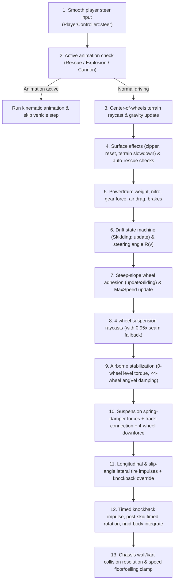
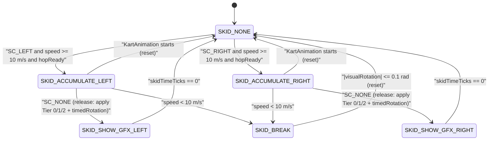

# OpenKart Raycast Kart Physics Specification

This document specifies OpenKart's custom Luau raycast kart physics solver (`src/shared/physics/KartSolver.lua`, `src/shared/kart/Skidding.lua`, `src/shared/kart/MaxSpeed.lua`, and `src/shared/KartTuning.lua`).

- **Upstream baseline:** SuperTuxKart `1.5` (`supertuxkart/stk-code`, commit `1fb491f507216c5d181ccd85f29ff08eca003827`; see [upstream.md](upstream.md)).
- **Accepted divergence:** Bullet (`lib/bullet` + `src/physics/btKart.cpp`) cannot run on Roblox. OpenKart implements a deterministic, pure-Luau rigid-body & 4-wheel raycast kart solver reproducing STK `1.5` kart-controller behavior, with every tuning constant sourced from upstream (`src/shared/KartTuning.lua`, zero magic numbers in the solver).
- **Gate alignment:** Designed for the Month 1 physics skeleton and the **Month 2 GO/NO-GO gate ("does drift feel good")**. Every handling target in Section 8 is directly measurable in headless Lune tests (`lune run tests/run.luau`) and Studio telemetry before human feel playtests.

---

## 1. Architectural Decisions & Coordinate Conventions

### 1.1 Locked Design Decisions

| Decision | Choice | Rationale |
|---|---|---|
| **Simulation tick rate** | `120 Hz` (`FIXED_DT = 1 / 120 s`) | Matches STK `1.5` (`data/stk_config.xml:L147`) 1:1; preserves integer tick timers (`Skidding`, `MaxSpeed`, timed knockback/rotation, nitro) and keeps the stiff suspension spring ($\omega_n \Delta t \approx 0.28$) comfortably stable. Driven by a variable-`dt` `Heartbeat` accumulator ([FixedStep.lua](../src/shared/sim/FixedStep.lua): `FIXED_DT = 1/120`, `MAX_FRAME_DT = 0.25`, `MAX_SUBSTEPS = 8`) — never assumes a 60 Hz `Heartbeat`. |
| **Internal solver units** | **SI metric** (`m`, `kg`, `s`, `N`, `rad`) | Allows direct 1:1 transcription of STK `1.5` equations and `KartTuning.lua` constants without error-prone compound unit conversions (`N·m`, `kg·m²`). Spatial boundary conversions happen exclusively via [Units.lua](../src/shared/Units.lua) (`1 stud = 0.28 m`). |
| **Integration backing** | **Pure-Luau rigid-body integrator** | Solver owns chassis `(position, orientation, linearVel, angularVel)` and calls an injected `WorldQuery` interface (`raycast`, `sweepChassis`). Runs identically in headless Lune tests and Roblox Studio/Server, enabling deterministic client prediction and server reconciliation. Visual/collider `Model` is anchored and driven by interpolated `CFrame`. |
| **Tire lateral & drift model** | **Parameterized slip-angle → grip curve + STK-faithful `Skidding` state machine** | Replaces Bullet's bilateral lateral constraint without low-speed jitter while hitting STK's `R(v)` turn radii. Preserves STK's exact 6-state `Skidding` machine (steering remap `[0.2, 0.8]`, visual yaw, post-skid `timedRotation`) with an explicit `driftRearGripScale` hook (default `1.0` for pure STK fidelity; tunable `< 1.0` during Month 2 feel testing). |

### 1.2 Coordinate Frames & Boundary Conversions

Recorded from `C:\dev\stk-code\README.md` and [Units.lua](../src/shared/Units.lua):

| Quantity | STK Internal Frame (Solver) | Roblox World Frame (Boundary) | Conversion |
|---|---|---|---|
| Right axis | `+X` | `+X` | `x_rbx = x_stk * STUDS_PER_METER` |
| Up axis | `+Y` | `+Y` | `y_rbx = y_stk * STUDS_PER_METER` |
| Forward axis | `+Z` | `-Z` (`CFrame.LookVector`) | `z_rbx = -z_stk * STUDS_PER_METER` |
| Yaw sign (turn left / right) | STK `steer < 0` turns right, `steer > 0` turns left (see `player_controller.cpp:L288-L297`, `skidding.cpp:L184-L209`) | Right-handed `+Y` yaw: `+yaw` rotates `-Z` toward `-X` (left) | Solver uses STK sign convention internally; boundary flips `Z` and hands a standard right-handed `CFrame` to Roblox. |
| Scale factor | `1.0 m` | `3.5714285714 studs` (`1 / 0.28`) | `Units.metersToStuds` / `Units.studsToMeters` |

---

## 2. Fixed Timestep & Per-Tick Pipeline

### 2.1 Accumulator & Tick Helpers

Mirrors `src/config/stk_config.hpp:L314-L317` and `src/main_loop.cpp:L460-L463`; implemented in [FixedStep.lua](../src/shared/sim/FixedStep.lua) and verified in [FixedStep.spec.luau](../tests/FixedStep.spec.luau):

```text
PHYSICS_FPS   = 120
FIXED_DT      = 1 / PHYSICS_FPS       -- 0.008333... s
MAX_FRAME_DT  = 0.25                  -- 0.25 s clamp against stalls / alt-tab
MAX_SUBSTEPS  = 8                     -- hard cap per frame (prevents spiral of death)

ticksToTime(ticks) = ticks / PHYSICS_FPS
timeToTicks(sec)   = math.floor(sec * PHYSICS_FPS)   -- matches C++ int(t * m_physics_fps)
```

Frame stepping loop (decoupled from variable-`dt` `Heartbeat` / render framerate):
1. Ignore `rawDt <= 0`; otherwise clamp `frameDt = math.min(rawDt, MAX_FRAME_DT)`.
2. `accumulator += frameDt`; `steps = 0` (remainder always carries across frames).
3. While `accumulator + 1e-9 >= FIXED_DT` and `steps < MAX_SUBSTEPS`:
   - Snapshot `prevState` (position, orientation, visual skid yaw, visual hop height).
   - Advance `simTick += 1` and run `KartSolver.step(state, input, worldQuery, FIXED_DT)`.
   - `accumulator = math.max(0, accumulator - FIXED_DT)`; `steps += 1`.
4. If `steps == MAX_SUBSTEPS` and `accumulator + 1e-9 >= FIXED_DT`, drop `accumulator` to `0` and emit a telemetry/warn log with the dropped debt seconds (`onDebtDropped`).
5. Render interpolation uses `alpha = math.clamp(accumulator / FIXED_DT, 0, 1)` to `Lerp` / `Slerp` `prevState → currState` before writing the visual `CFrame`.

#### Multiplayer Clock & Debt-Shedding Invariants
- **Substep cap & low-FPS shedding:** `MAX_SUBSTEPS = 8` caps simulation work per frame at `8 / 120 ≈ 66.7 ms` (`~15 fps`). Below `~15 fps`, remaining accumulator debt is shed via `onDebtDropped`.
- **Single authoritative simulation clock:** The server's integer tick counter (`simTick`) is the **single authoritative simulation clock**. Because a lagging client or server can shed different tick counts if uncoordinated, server debt shedding must be broadcast with the authoritative `simTick` and state snapshot, and clients must always reconcile to the server's `simTick` — never their own local tick counter.
- **Wall-clock race & lap timers:** Match clocks, lap timers, and split/finish times must use wall-clock time (`workspace:GetServerTimeNow()`), **never** accumulated simulation ticks (`simTick * FIXED_DT`), so a lagging server never yields slower race times for everyone.

### 2.2 Per-Tick Execution Order

Preserves the exact causal ordering of `Kart::update` (`src/karts/kart.cpp:L1365-L1803`) → `Kart::updatePhysics` (`kart.cpp:L2610-L2675`) → `btKart::updateVehicle` (`src/physics/btKart.cpp:L428-L535`):



---

## 3. Chassis Geometry & 4-Wheel Raycast Suspension

### 3.1 Chassis Bounds, CoG Shift & Wheel Hardpoints

Sourced from `src/karts/kart.cpp:L659-L799`, `src/karts/kart_properties.cpp:L363-L377`, `data/stk_config.xml:L478-L481`, and `data/official_karts.xml`:

- **Effective collision height:** `h = math.min(modelHeight, 0.6 * length)` (prevents tall characters from tipping).
- **Wheelbase:** `wheelBase = length` (e.g., `1.437 m` for `tux`).
- **Bevelled hull:** `bevel = (0.5, 0.0, 0.3)` (`X`, `Y`, `Z` bevel fractions). With `physicalWheelPosition = 0`, the 4 wheel attachment hardpoints sit at the widest bevel corners on the bottom face of the hull:
  - Front-Left (`i = 0`), Front-Right (`i = 1`), Rear-Left (`i = 2`), Rear-Right (`i = 3`).
  - `x_i = ±0.5 * width`, `z_i = ±0.5 * length * (1 - bevel.Z)` (or XML fallback `(±0.38, 0, ±0.6)` when no model extents are loaded).
  - `y_i = -0.5 * h + gravityShift.Y`. Since default `gravityShift = (0, 0.5 * h, 0)`, `y_i = 0` in shifted CoG space — placing the center of gravity at the wheel-attachment plane to strongly resist rollover.
- **Inertia & angular factor:** Solid-box inertia tensor for `(width, h, length, mass)`, scaled per axis by `angularFactor = (0.25, 1.0, 0.5)` (`pitch, yaw, roll` impulse multipliers; `kart_characteristics.xml:L58`) so collisions do not easily roll or pitch-flip the kart.

### 3.2 Wheel Raycasts & Seam Fallback

Sourced from `src/physics/btKart.cpp:L225-L359`:

- Suspension parameters:
  - `rest = 0.30 m` (`1.071 studs`)
  - `travel = 0.29 m` (`1.036 studs`)
  - `minSuspLen = rest - travel = 0.01 m` (`0.036 studs`)
  - `maxSuspLen = rest + travel = 0.59 m` (`2.107 studs`)
  - `rayLen = maxSuspLen + 0.50 = 1.09 m` (`3.893 studs`)
- For each wheel `i ∈ {0, 1, 2, 3}`:
  1. Transform hardpoint `hardPointWS = chassisPos + chassisRot * (hardPointCS * fraction)` with `fraction = 1.0` and wheel ray direction `wheelDirWS = chassisRot * (0, -1, 0)`.
  2. Cast ray from `hardPointWS` to `hardPointWS + wheelDirWS * rayLen` (filtering out the kart's own collider and non-driveable triggers).
  3. Contact is valid iff the ray hits AND `depth < maxSuspLen`.
  4. **5% inward seam fallback (`btKart.cpp:L234-L241`):** If the initial raycast misses, immediately retry with `fraction = 0.95` (5% closer to chassis center) to prevent spurious wheel drops across minor track triangle seams.
  5. If in contact:
     - `suspLen = clamp(depth, minSuspLen, maxSuspLen)`.
     - `denom = dot(contactNormalWS, wheelDirWS)`.
     - If `denom >= -0.1` (near-perpendicular wall graze): `vRel = 0`, `clippedInvDot = 10.0`.
     - Else: `clippedInvDot = -1 / denom`, `vRel = dot(contactNormalWS, velocityAt(contactPointWS)) * clippedInvDot`.
  6. If not in contact: `suspLen = rest`, `vRel = 0`, `contactNormalWS = -wheelDirWS`, `clippedInvDot = 1.0`.
- `numWheelsOnGround` = count of wheels with `isInContact == true`.
- `isOnGround = (numWheelsOnGround == 4) and (activeAnimation == nil)` (`kart.cpp:L1241-L1245`).

### 3.3 Spring, Asymmetric Damper, Track-Connection & Downforce

Sourced from `src/physics/btKart.cpp:L465-L500`, `L586-L639`, `data/kart_characteristics.xml:L37-L59,125`:

1. **Per-wheel suspension force (`isInContact == true`):**
   - `lengthDiff = rest - suspLen` (if `expSpringResponse == true`, `lengthDiff *= |lengthDiff| / rest`; default `false`).
   - `springTerm = stiffness * lengthDiff * clippedInvDot` (`stiffness = 280`).
   - Asymmetric damping:
     - Compressing (`vRel < 0`): `damping = dampingCompression` (`15`)
     - Rebounding (`vRel >= 0`): `damping = dampingRelaxation` (`35`)
   - `F_wheel = clamp((springTerm - damping * vRel) * mass, 0, maxSuspensionForce)` (`maxSuspensionForce = 32000 N`).
   - Apply impulse `J_susp = contactNormalWS * F_wheel * dt` at `relPos = contactPointWS - chassisPos`.
   - Note on stability: at rest on flat ground with 4 wheels (`m = 262.5 kg`), static sag is $\Delta L_0 = g / (4 \cdot 280) \approx 0.0088\text{ m}$, natural frequency is $\omega_n = \sqrt{4 \cdot 280} \approx 33.47\text{ rad/s}$ ($5.33\text{ Hz}$), compression damping ratio is $\zeta_c \approx 0.45$, and rebound damping ratio is $\zeta_r \approx 1.05$ (critically damped, preventing pogo oscillation).
2. **Off-ground wheel pull (`isInContact == false`, `btKart.cpp:L595-L611`):**
   - `F_wheel = -trackConnectionAccel * mass` (`trackConnectionAccel = 2.0 m/s²`), applied along `contactNormalWS` (= chassis `+Y`, so force acts along chassis `-Y`).
   - Pulls a lifted axle back onto steep/uneven crests and adds `4 × 2.0 = 8.0 m/s²` extra effective gravity when all 4 wheels are airborne (essential to match STK track jump arcs).
3. **4-wheel speed-proportional downforce (`btKart.cpp:L493-L500`):**
   - When `numWheelsOnGround == 4`: apply central impulse along chassis local `-Y` of magnitude `|speed| * downwardImpulseFactor` (`downwardImpulseFactor = 5.0` per 120 Hz tick; note: if tick rate ever changes from `120 Hz`, scale by `dt * 120` so effective force `600 * |speed| N` remains tick-rate invariant).
   - At `25 m/s` on Medium (`262.5 kg`), downforce increases steady suspension sag from `0.0088 m` to `~0.060 m`, leaving `~0.23 m` of compression travel.
4. **Terrain surface query (`kart.cpp:L1559-L1581`):**
   - Cast a single center ray downward from `avg(hardPointWS[0..3]) + chassisUp * 0.30` to determine active ground `Material` (zipper, reset, slowdown, high-adhesion, custom gravity, falling effect) and height-over-terrain (`HoT`).

---

## 4. Powertrain, Steering & Slip-Angle → Grip Curve

### 4.1 Longitudinal Powertrain, Gears, Air Drag & Braking

Sourced from `src/karts/kart.cpp:L1216-L1235`, `L2738-L2893`, `L3079-L3096`, `src/karts/max_speed.cpp`:

1. **Effective base gear force (`getActualWheelForce`):**
   - Find lowest gear `k` where `speed <= engineMaxSpeed * gearSwitchRatio[k]`; `wheelForce = enginePower * gearPowerIncrease[k] + maxSpeed.additionalEngineForce`.
   - If `speed` exceeds all gear ratios, `wheelForce = enginePower + 2 * maxSpeed.additionalEngineForce`.
   - If nitro boost ticks `> 0`: `wheelForce *= nitroEngineMult` (`1.2`).
   - If bubblegum active (`bubblegumTicks > 0`): `wheelForce = 0`, apply yaw torque `±bubblegumTorque` (`±500 N·m`).
   - If throttle lockout active (`bounceBackTicks > 0`): `wheelForce = 0`.
   - If accelerating while rolling backwards (`speed < 0`): `wheelForce *= 5.0` (snappy recovery after backing out of a wall).
2. **Air friction & linear-damping compensation (`applyAirFriction`, `kart.cpp:L2738-L2773`):**
   - Grounded chassis linear damping is `chassisLinearDamping = 0.2` (`kart_characteristics.xml:L54`).
   - STK compensates Bullet's linear damping before applying its nonlinear drag:
     $$F_{\text{net}} = F_{\text{wheel}} + 39.33 \cdot |v| \cdot \frac{m}{350} - 5 \cdot |v|^{1.5} \cdot \mu_{\text{parachute}}$$
     where $\mu_{\text{parachute}} = 5.0$ if a parachute is attached, else $1.0$.
   - *Solver note:* Because our pure-Luau integrator applies the same exponential/Euler linear damping (`0.2` when grounded, `0.0` when airborne), preserving `applyAirFriction` reproduces STK's exact acceleration curve across all gears and kart masses!
3. **4WD wheel force split (`kart.cpp:L3079-L3096`):**
   - Each front wheel receives `0.4 * F_applied`; each rear wheel receives `0.6 * F_applied`.
   - Summed across 4 grounded wheels, total longitudinal thrust is `(0.4 + 0.4 + 0.6 + 0.6) * F_applied = 2.0 * F_applied`, applied centrally (`relPos = 0`, matching `COMPATIBLE_0_7_3` in `btKart.cpp:L842-L845` so acceleration does not pitch the nose up).
4. **Braking, reverse & parking brake (`kart.cpp:L2829-L2893`):**
   - Brake while moving forward (`speed > 0`): `F_applied = F_net - 3 * brakingPower`; `brakeTicks += 1`; wheel brake impulse limit `brakeLimit = brakeFactor * (1 + ticksToTime(brakeTicks) * brakeTimeIncrease)` (`brakeFactor = 15`, `brakeTimeIncrease = 6`).
   - Brake while `speed <= 0` (reverse): `brakeLimit = 0`; if `-speed < currentMaxSpeed * maxSpeedReverseRatio`, apply `F_net - 3 * brakingPower`, else `0`.
   - Coasting (neither throttle nor brake):
     - If `|speed| < 5.0 m/s`: parking brake (`F_applied = 0`, `brakeLimit = 20.0`) so karts stop crisply on slopes/arenas.
     - Else: `F_applied = F_net - brakingPower` (pure air/parachute drag slowdown), `brakeLimit = 0`.
   - Zero-speed deadband (`kart.cpp:L1838`): if `|speed| < 0.2 m/s`, reported scalar `speed = 0` to eliminate standstill sign jitter.

### 4.2 Speed-Indexed Steering Geometry & Input Ramp

Sourced from `src/karts/controller/player_controller.cpp:L268-L313`, `src/karts/kart.cpp:L912-L924`, `data/kart_characteristics.xml:L82-L84`:

- **Digital input ramp:**
  - Steering toward center or opposite sign: `Δsteer = dt / timeResetSteer` (`timeResetSteer = 0.10 s`).
  - Steering further into a turn: `Δsteer = dt / timeFullSteer(|steer|)`, piecewise `0.17 s` for `|steer| ∈ [0, 0.5]` and `0.28 s` for `|steer| ∈ (0.5, 1.0]` → total `0 → 1` lock time `0.225 s` (`27 ticks`).
- **Speed-indexed turn radius → wheel steer angle:**
  - Piecewise-linear interpolation of `turnRadius(speed)` (Medium: `0:2.30, 10:8.625, 25:17.25, 45:34.50 m`).
  - Convert each table entry `R_k` to wheel angle `δ_k = sin(1 / R_k) * wheelBase`, then linearly interpolate `maxSteerAngle(speed)` (`kart.cpp:L919-L923`).
  - Front wheel steer angle: `δ_front = maxSteerAngle(speed) * skidding.steeringFraction` (`kart.cpp:L2649-L2651`); rear wheel steer angle `δ_rear = 0`.

### 4.3 Slip-Angle → Lateral Grip Curve (Luau Solver)

In upstream STK `1.5`, `<friction slip="10000000"/>` (`stk_config.xml:L435`) disables Bullet tire breakaway on flat ground and `btKart::updateFriction` solves a bilateral zero-lateral-velocity impulse per wheel, falling back to zero grip during knockback (`ticksAdditionalImpulse > 0`) and reduced grip on steep slopes (`updateSliding`, `kart.cpp:L2906-L2958`).

To replace Bullet's bilateral constraint solver with a smooth, jitter-free pure-Luau tire model that faithfully hits STK's turning radii and slope/knockback rules:

1. **Wheel ground basis (per grounded wheel `i`):**
   - Wheel right axis `axle_i` = front-steered or rear chassis right axis projected onto the contact plane (`axle_i = normalize(rawAxle_i - n_i * dot(rawAxle_i, n_i))`).
   - Wheel forward axis `fwd_i = normalize(cross(n_i, axle_i))` (adjusted for right-handed convention so `fwd_i` points along wheel travel).
   - Contact patch velocity `v_i = linearVel + cross(angularVel, relPos_i)`.
   - Decompose into `v_fwd = dot(v_i, fwd_i)` and `v_lat = dot(v_i, axle_i)`.
2. **Wheel slip angle (`α_i`), zero-velocity guard & reverse handling:**
   - **Zero-velocity floor (`SPEED_FLOOR = 0.05 m/s`):** If wheel contact-patch planar speed $\sqrt{v_{\text{fwd},i}^2 + v_{\text{lat},i}^2} < 0.05\text{ m/s}$, return $\alpha_i = 0$ immediately (eliminates the `atan2(0, 0)` singularity at rest and guarantees steering at rest never rotates the chassis).
   - **Reverse sign safety (`v_fwd < 0`):** Raw $\operatorname{atan2}(v_{\text{lat}}, v_{\text{fwd}})$ with negative $v_{\text{fwd}}$ returns $\pm\pi$ and flips grip sign when reversing. Therefore always compute:
     $$\alpha_i = \operatorname{atan2}\!\left(v_{\text{lat},i},\ \max(|v_{\text{fwd},i}|,\ v_\epsilon)\right), \qquad v_\epsilon = 0.5\text{ m/s}$$
     and apply lateral force $F_{\text{lat},i} = -\operatorname{sign}(v_{\text{lat},i}) \cdot |\mu(\alpha_i)| \cdot g_{\text{eff},i} \cdot F_{N,i}$, guaranteeing lateral tire force always opposes $v_{\text{lat},i}$ in both forward and reverse travel.
   - *(Mandatory Lune pre-solver tests: standstill steering zero-yaw, `|v| < 0.05 m/s` slip=0, and negative `v_fwd` reverse cornering without grip inversion.)*
3. **Slip-Angle → Grip Curve ($\mu(\alpha)$):**
   Use a simplified Pacejka Magic Formula (peak-normalized lateral friction coefficient):
   $$\mu(\alpha) = \mu_{\text{peak}} \cdot \sin\!\left(C \cdot \arctan\!\left(B \cdot \alpha - E\,(B \cdot \alpha - \arctan(B \cdot \alpha))\right)\right)$$
   Default solver curve coefficients (calibrated for STK's high-grip arcade tracking):

   | Parameter | Default | Role |
   |---|---|---|
   | `B` (stiffness factor) | `12.0` | Steep linear cornering stiffness at small slip angles (`0°–5°`) so normal turning tracks `R(v)` tightly without understeer mushiness. |
   | `C` (shape factor) | `1.35` | Broad plateau after peak (`α_peak ≈ 8°–12°`) with gentle falloff, preventing sudden snap-oversteer. |
   | `E` (curvature factor) | `-0.5` | Smooths peak transition. |
   | `μ_peak` (base peak grip) | `2.8` | Sufficient lateral authority to hold `25 m/s` around `R = 17.25 m` ($a_{\text{lat}} = v^2 / R = 36.2\text{ m/s}^2$, well supported under 4-wheel downforce where $F_{N,\text{total}} / m \approx 67\text{ m/s}^2$). |

4. **Grip Modifiers & Impulse Clamp:**
   Compute the per-wheel lateral grip scale:
   $$g_{\text{eff},i} = g_{\text{slope},i} \cdot g_{\text{mat}} \cdot g_{\text{drift},i} \cdot g_{\text{knockback}}$$
   - **Steep-slope sliding (`kart.cpp:L2906-L2958`):** Let $d = \operatorname{dot}(n_i, \hat{u}_{\text{grav}})$.
     - If material has `highTireAdhesion`: $g_{\text{slope},i} = 1.0$.
     - Else if $d > 0.90$: $g_{\text{slope},i} = 1.0$.
     - Else if $d < 0.85$: $g_{\text{slope},i} = 0.0$ (kart slides off walls/steep ledges).
     - Else ($0.85 \le d \le 0.90$): linear ramp $g_{\text{slope},i} = (d - 0.85) / 0.05$ *(note: STK `kart.cpp:L2951` has a literal `/ 0.5f` giving `[0, 0.1]` ramp before jumping to `1.0` at `0.90`; flag in `KartTuning.lua` whether to match STK's `0.5f` divisor or smooth `0.05f` ramp)*.
   - **Surface material grip:** $g_{\text{mat}}$ defaults to `1.0` (e.g., ice materials lower $g_{\text{mat}}$).
   - **Drift rear grip hook:** $g_{\text{drift},i} = 1.0$ on front wheels; on rear wheels while in `SKID_ACCUMULATE_*`, $g_{\text{drift},i} = \texttt{driftRearGripScale}$ (default `1.0` for pure STK `1.5` fidelity; tunable `< 1.0` during Month 2 playtests without changing the solver architecture).
   - **Knockback release (`btKart.cpp:L787-L791`):** When `ticksAdditionalImpulse > 0`, $g_{\text{knockback}} = 0.0$ so tires do not immediately fight lateral knockback impulses.
   - **Impulse calculation & overshoot guard:**
     - Desired lateral force: $F_{\text{lat},i} = -\operatorname{sign}(v_{\text{lat},i}) \cdot |\mu(\alpha_i)| \cdot g_{\text{eff},i} \cdot F_{N,i}$.
     - Convert to impulse $J_{\text{lat},i} = F_{\text{lat},i} \cdot \Delta t$, **clamped** so it never reverses the wheel's lateral velocity in a single step:
       $$|J_{\text{lat},i}| \le |J_{\text{stop},i}| = \frac{|v_{\text{lat},i}|}{m^{-1} + \operatorname{dot}(\text{axle}_i,\ (I^{-1}(r_i \times \text{axle}_i)) \times r_i)}$$
     - Apply $J_{\text{lat},i} \cdot \text{axle}_i$ at roll-attenuated lever arm `relPos_lat = relPos_i - chassisUp * (dot(relPos_i, chassisUp) * (1 - rollInfluence))` (`rollInfluence = 0.3`, matching `btKart.cpp:L870-L878`).
   - **Traction circle coupling:** When sliding is active ($g_{\text{eff},i} < 1.0$), scale $(J_{\text{fwd},i} \cdot 0.5,\ J_{\text{lat},i})$ uniformly if $\sqrt{(0.5 J_{\text{fwd},i})^2 + J_{\text{lat},i}^2} > g_{\text{eff},i} \cdot \mu_{\text{peak}} \cdot F_{N,i} \cdot \Delta t$, matching `btKart.cpp:L794-L828`.

### 4.4 Speed Floor / Ceiling Enforcement (`MaxSpeed`)

Sourced from `src/karts/max_speed.cpp:L400-L455` and `src/physics/btKart.cpp:L963-L993`:

- Active **slowdowns** (`TERRAIN`, `AI`, `BUBBLE`, `SQUASH`) take the **minimum** `currentFraction` (each fading in linearly over `fadeInTicks`).
- Active **speed increases** (`ZIPPER`, `SLIPSTREAM`, `NITRO`, `RUBBER`, `SKIDDING`, `RED_SKIDDING`) sum their `currentSpeedup` (holding constant during `duration > 0`, then linearly fading to `0` over `fadeOutTicks`), **except** `RED_SKIDDING` suppresses `SKIDDING` when both are active (`max_speed.cpp:L427-L433`).
- `currentMaxSpeed = (baseMaxSpeed + sumSpeedIncreases) * minSlowdownFraction`.
- At the end of each tick (`btKart::adjustSpeed`):
  - If `minSpeed > 0` and `|v| < minSpeed`: scale planar velocity (component orthogonal to terrain normal) up to `minSpeed` while preserving vertical/normal velocity.
  - Else if `isOnGround` and `|v| > currentMaxSpeed`: scale velocity down to `currentMaxSpeed`.
  - When airborne (`!isOnGround`): ceiling is relaxed to `9999.9 m/s` (uncapped).

---

## 5. Drift State Machine with Charge Tiers

Ported faithfully from `src/karts/skidding.{hpp,cpp}` and `data/kart_characteristics.xml:L169-L176`.

### 5.1 State Diagram



### 5.2 Input Latching & Entry Hop

- **Direction latch (`player_controller.cpp:L157-L170, L225-L243`):**
  - Pressing drift while `steer == 0` sets `skidControl = SC_NO_DIRECTION`. As soon as left or right is pressed while holding drift, `skidControl` latches to `SC_LEFT` or `SC_RIGHT` until drift is released (`SC_NONE`).
- **Entry preconditions (`skidding.cpp:L431-L445`):**
  - `skidControl` is `SC_LEFT` or `SC_RIGHT`, `remainingJumpTime <= 0`, `speed >= skidMinSpeed` (`10.0 m/s` = `35.71 studs/s`), and no active `KartAnimation`.
- **Entry hop (`skidding.cpp:L330-L342, L450-L465`):**
  - Default `physicalJumpTime = 0.0 s` (no vertical physics impulse), `graphicalJumpTime = 0.4 s`.
  - Visual chassis height offset during hop:
    $$h(t) = v_0\,t - \tfrac{1}{2} g t^2, \qquad v_0 = \tfrac{1}{2} g T_{\text{hop}}, \qquad h_{\max} = \frac{g T_{\text{hop}}^2}{8} \approx 0.196\text{ m } (0.70\text{ studs})$$
  - Re-entering a new skid is blocked while `remainingJumpTime > 0`.

### 5.3 Steering Remap, Visual Yaw & Skid Factor

Sourced from `skidding.cpp:L148-L221` and `L382-L406`:

- **Locked-direction steering remap** (`reduceTurnMin = 0.2`, `reduceTurnMax = 0.8`, `delta = 0.6`):
  - `SKID_ACCUMULATE_RIGHT`: $f = \frac{1 + \text{steer}}{2} \in [0, 1]$, $\text{steerResult} = 0.2 + 0.6 f \in [+0.2,\ +0.8]$.
  - `SKID_ACCUMULATE_LEFT`: $f = \frac{-1 + \text{steer}}{2} \in [-1, 0]$, $\text{steerResult} = -0.2 + 0.6 f \in [-0.8,\ -0.2]$.
  - Players steer counter-direction to widen the drift line (`0.2×` turn) or into the turn to carve tight hairpins (`0.8×` turn), while never breaking out of the drift direction until release.
- **Visual drift yaw (`visualRotation`):**
  - Ramps linearly over `skidVisualTime = 0.7 s`:
    $$\psi_{\text{vis}} = \operatorname{clamp}\!\left(\texttt{skidVisual} \cdot \text{steerResult} \cdot \min\!\left(1,\ \frac{t_{\text{skid}}}{0.7}\right),\ -1.0,\ +1.0\right)\text{ rad}$$
    where `skidVisual = 1.25` (so at full inner lock `steerResult = 0.8`, $\psi_{\text{vis}}$ reaches `1.0 rad ≈ 57.3°`).
- **Skid factor & airtime charge persistence (`src/karts/skidding.cpp:L376-L406, L525-L536`):**
  - When grounded (`isOnGround`), `|steer| > 0.001`, `speed > 10 m/s`, and skidding: `skidFactor += skidIncrease * dt / skidTimeTillMax` (`1.05 * dt / 0.5`).
  - When grounded and not actively skidding: `skidFactor *= skidDecrease` (`0.95` per tick).
  - When airborne (`!isOnGround`): `skidFactor = 1.0` immediately (`skidding.cpp:L399`).
  - **Airtime / landing charge persistence (`skidding.cpp:L376-L380, L525-L581`):** While `m_skid_factor` resets to `1.0` during airtime, `m_skid_state` stays in `SKID_ACCUMULATE_*` and `m_skid_time` **continues accumulating** (and can trigger a release boost if released mid-air/on landing) as long as `speed >= skidMinSpeed` (`10.0 m/s`) and drift remains held; only `speed < 10.0 m/s` transitions to `SKID_BREAK`. *(Upstream-feel audit item for Month 2: confirm whether brief hop/crest airtime keeping charge matches `skidding.cpp` feel on Roblox tracks.)*

### 5.4 Charge Tiers & Post-Skid Release

Sourced from `skidding.cpp:L525-L624` and `data/kart_characteristics.xml:L171-L176`:

| Tier | Condition (`t_skid`) | Visual Cue | Max Speed Bonus | Instant Speed Gain (`bonusSpeed / 2`) | Extra Engine Force | Hold Duration | Fade-Out | `MaxSpeed` Category |
|---|---|---|---|---|---|---|---|---|
| **Tier 0 (None)** | `t <= 1.0 s` (`≤ 120 ticks`) | Small white/neutral sparks | `+0.0 m/s` (`0 studs/s`) | `+0.0 m/s` | `+0` | `0.0 s` | — | — |
| **Tier 1 (Yellow)** | `1.0 s < t <= 3.0 s` (`121..360 ticks`) | Yellow sparks + yellow glow | `+4.5 m/s` (`+16.07 studs/s`) | `+2.25 m/s` (`+8.04 studs/s`) | `+250` | `3.0 s` (`360 ticks`) | `1.0 s` (`120 ticks`) | `MS_INCREASE_SKIDDING` |
| **Tier 2 (Red)** | `t > 3.0 s` (`> 360 ticks`) | Red/orange sparks + red glow | `+6.5 m/s` (`+23.21 studs/s`) | `+3.25 m/s` (`+11.61 studs/s`) | `+350` | `4.0 s` (`480 ticks`) | `1.0 s` (`120 ticks`) | `MS_INCREASE_RED_SKIDDING` *(replaces Tier 1)* |

- **On release (`SKID_ACCUMULATE_* → SKID_SHOW_GFX_*`):**
  1. Compute revert time `t_revert = min(t_skid, skidVisualTime=0.7, skidRevertVisualTime=0.7)`.
  2. Schedule physical chassis alignment rotation (`btKart::setTimedRotation`, `btKart.hpp:L248-L256`, `btKart.cpp:L514-L533`):
     - `ticksAdditionalRotation = timeToTicks(t_revert)`
     - `additionalRotationRate = (visualRotation * postSkidRotateFactor) / ticksToTime(ticksAdditionalRotation)` (`postSkidRotateFactor = 1.0`).
     - Each tick, multiply chassis yaw by `additionalRotationRate * dt` while `visualRotation` linearly decays back to `0` over the same `t_revert` ticks — smoothly aligning physical travel direction with the visual nose heading.
  3. If Tier ≥ 1, apply `MaxSpeed.instantSpeedIncrease(...)` per the table above.
  4. Re-entering a new skid is held off until `SKID_SHOW_GFX_*` finishes (`skidTimeTicks == 0 → SKID_NONE`).
- **On abort (`speed < 10.0 m/s → SKID_BREAK`):**
  - No boost, no `timedRotation`; `visualRotation` steps toward `0` by `0.1 rad/tick` until `|visualRotation| <= 0.1`, then `Skidding.reset()`.

---

## 6. Airtime Physics & Recovery

Sourced from `src/physics/btKart.cpp:L438-L461`, `L595-L611`, `src/karts/kart.cpp:L1241-L1258`, `L1513-L1529`, `L1602-L1617`, `L1696-L1708`, `L1760-L1801`, `src/karts/max_speed.cpp:L450-L453`:

| Condition | Behavior | Upstream Citation |
|---|---|---|
| **`numWheelsOnGround == 4`** (`isOnGround == true`) | Full traction/powertrain; linear damping `0.2`; speed-proportional downforce `-|v| * 5`; `MaxSpeed` ceiling enforced; nitro allowed. | `kart.cpp:L1241, L1525-L1529`, `btKart.cpp:L493-L500` |
| **`1 <= numWheelsOnGround <= 3`** (partial contact / cresting) | Grounded wheels still apply suspension & tire forces; off-ground wheels apply `-trackConnectionAccel * mass` (`-2 * m`); angular velocity damped per tick (`av.X *= 0.95`, `av.Y *= 0.25`, `av.Z *= 0.95`); linear damping `0.0`; `MaxSpeed` uncapped (`9999.9`); nitro boost paused; `skidFactor` resets to `1.0`, while `skidState` & `skidTime` persist across brief airtime as long as `speed >= 10 m/s` and drift stays held. | `kart.cpp:L1513-L1524, L2268`, `btKart.cpp:L595-L611`, `skidding.cpp:L376-L400, L525-L536`, `max_speed.cpp:L450-L453` |
| **`numWheelsOnGround == 0`** (fully airborne) | All partial-contact rules above, **plus**: zero chassis pitch & roll angular velocity (`av.X = 0`, `av.Z = 0`) and apply uprighting torque impulse `cross(kartUp, gravityUp) * smoothFlyingImpulse` (`250`) to level the kart parallel to gravity/track. Effective vertical gravity is `g + 4 * trackConnectionAccel = 17.80665 m/s²` (`63.60 studs/s²`). | `btKart.cpp:L438-L461, L595-L611` |
| **Jump animation trigger** | When leaving ground onto a different/nil material, estimate ballistic hangtime `t_air = 2 * vy / g`; trigger jump animation if `t_air > 0.5 s` or takeoff material has `isJumpTexture`. | `kart.cpp:L1760-L1788`, `kart_characteristics.xml:L195` |
| **Near-ground check** | `heightAboveTerrain < nearGroundDistance` (`2.0 m` = `7.14 studs`). | `kart.cpp:L1251-L1258`, `stk_config.xml:L211` |
| **Upside-down auto-rescue** | If track auto-rescue enabled, not on custom-gravity material, `|rollAngleToQuadNormal| > 60°`, and `|speed| < 3.0 m/s` → trigger `RescueAnimation` (`duration = 1.2 s`, `height = 2.0 m`). | `kart.cpp:L1608-L1616`, `kart_characteristics.xml:L292` |
| **Void-fall auto-rescue** | If terrain raycast misses (`material == nil`) and (`trackAABB.minY - y > 17.0 m` or `distToSector > 25.0 m`) → trigger `RescueAnimation`. | `kart.cpp:L1696-L1708` |

---

## 7. Knockback Impulses & Collision Responses

The solver exposes a unified impulse/disruption queue supporting both instantaneous impulses and STK's **timed central impulses** (`setTimedCentralImpulse(ticks, impulsePerSec)`, `btKart.hpp:L228-L235`, `btKart.cpp:L504-L510`):

- **Non-stacking guard:** A new timed impulse is ignored if `ticksAdditionalImpulse > 0` (prevents multi-contact frame explosion; bypassed on server reconciliation rewind).
- **Per-tick application:** Applies `impulsePerSec * dt` to linear momentum, decrements `ticksAdditionalImpulse -= 1`, and sets tire `g_knockback = 0` (`skidInfo = 0`) so tires slide freely instead of fighting the knockback.

### 7.1 Kart–Kart Lateral Knockback (`src/physics/physics.cpp:L438-L558`)

1. Determine `leftKart` vs `rightKart` by comparing local-space contact point `X` (`contactA.X < contactB.X` → `rightKart = A`, `leftKart = B`).
2. Mass & speed scaling factor:
   $$f_R = \operatorname{clamp}\!\left(\frac{m_L}{m_R} \cdot \frac{v_L}{v_R},\ 0.8,\ 1.25\right), \qquad f_L = \frac{1}{f_R}$$
   (defaulting ratio to `1.5` if denominator `<= 0`).
3. Active ramming bonus from local lateral velocities (`velDiff = v_R.x + v_L.x`):
   - If `velDiff < 0` and `|v_L.x| > 2.0`: `f_L = min(2.0, f_L * (1 - velDiff / |v_L.x|))`.
   - Else if `velDiff >= 0` and `|v_R.x| > 2.0`: `f_R = min(2.0, f_R * (1 + velDiff / |v_R.x|))`.
4. Square both factors (`f_L = f_L²`, `f_R = f_R²`, yielding `[0.64, 4.0]`).
5. Apply timed central lateral impulse to each kart (if its `ticksAdditionalImpulse <= 0`):
   - `rightKart`: local `(+collisionImpulse * f_R, 0, 0)` over `collisionImpulseTime = 0.1 s` (`12 ticks`).
   - `leftKart`: local `(-collisionImpulse * f_L, 0, 0)` over `collisionImpulseTime = 0.1 s` (`12 ticks`).
   - Base `collisionImpulse = 3000 N` → total impulse `300 * f² N·s`.
   - Zero both karts' `angularVelocity` on impact to prevent chaotic spinouts.

### 7.2 Wall / Track Collisions & Push-Back Bumpers (`src/karts/kart.cpp:L2334-L2464`, `data/stk_config.xml:L478-L481`)

- **Standard walls (`Material::NORMAL`):**
  - Speed-dependent restitution piecewise-interpolated from `0:1.0, 5:1.0, 20:0.2` (updated every tick at `kart.cpp:L1454`).
  - Zero wall friction (`kartFriction = 0.0`, `kart_characteristics.xml:L133`) + bevelled hull (`0.5, 0.0, 0.3`) so glancing wall scrapes glide cleanly without snagging.
  - Note: STK's `IMPULSE_NORMAL` branch zeroes its extra terrain impulse (`kart.cpp:L2376-L2378`); the optional `IMPULSE_TO_DRIVELINE` mode uses `terrainImpulse = 160` over `0.1 s` with `0.2 s` throttle lockout (`bounceBackTicks`).
- **Bouncy bumpers (`Material::PUSH_BACK`, `kart.cpp:L2450-L2460`):**
  - If `bounceBackTicks <= timeToTicks(0.2 s)`: apply instant central impulse `-4000 * normalize(v)` (with `dir.Y` overridden to `0.1`) and set `bounceBackTicks = timeToTicks(2.0 s)` (disabling throttle so the kart cleanly bounces away).
- **Hazard walls (`Material::RESCUE`):** Immediately starts `RescueAnimation`.

### 7.3 Item & Hazard Disruptions

| Source | Physics Response | Upstream Citation |
|---|---|---|
| **Explosion** (cake, bowling, bomb, rubber ball) | Kinematic ballistic pop-up (`ExplosionAnimation`): `duration = 1.5 s` direct (`0.75 s` splash within `6.0 m` radius), vertical launch `v0 = 0.5 * duration * g`, multi-axis tumble, zeroes linear & angular velocity on landing, grants `7.0 s` invulnerability. | `explosion_animation.cpp:L181-L287`, `kart_characteristics.xml:L301-L302` |
| **Bubblegum** | Cuts engine power to `0`, slows max speed to `0.3×` (fade-in `0.01 s`) for `1.0 s`, applies yaw torque `±500 N·m`. | `kart.cpp:L1160-L1180, L2792-L2798`, `kart_characteristics.xml:L238-L239` |
| **Plunger (Rubber Band)** | Continuous central force `1500 N` pulling owner forward and target backward up to `50 m` for `1.0 s`; owner gets `+7 m/s` max speed (`3.0 s` fade-out). | `rubber_band.cpp:L304-L311`, `kart_characteristics.xml:L269-L271` |
| **Anvil** | Adds `+150 kg` chassis mass (`updateWeight`) and multiplies linear & angular velocity by `0.2` on attach for `2.0 s`. | `attachment.cpp:L383`, `kart.cpp:L865-L891`, `kart_characteristics.xml:L211` |
| **Parachute** | Multiplies nonlinear air drag in `applyAirFriction` by `5.0×` for `3.0 s` (detaches early if speed drops by fraction in `[0.3, 0.5]`). | `kart.cpp:L2760-L2761`, `kart_characteristics.xml:L229-L231` |
| **Swatter Squash** | Caps max speed to `0.5×` (fade-in `0.1 s`) for `5.0 s`. | `kart.cpp:L1862-L1882`, `kart_characteristics.xml:L260-L261` |

---

## 8. Measurable Handling-Targets Table

All targets below are calibrated for the **Medium reference kart (`tux`: `m = 262.5 kg`, `L = 1.437 m`, `W = 0.821 m`, `H = 0.675 m`) on `best` (100%) difficulty** over flat horizontal ground (`g = 9.80665 m/s²`), unless noted. Conversions use `1 stud = 0.28 m` ([Units.lua](../src/shared/Units.lua)).

Every metric is intended to be asserted in automated headless Lune tests (`lune run tests/run.luau`) before human Studio feel playtests.

| Category | Metric | Target (SI Metric) | Target (Roblox Studs) | Acceptance Tolerance | Verification Harness |
|---|---|---|---|---|---|
| **Top Speed** | Medium base top speed | `25.00 m/s` (`90.0 km/h`) | `89.29 studs/s` | `±0.10 m/s` | Flat straight, full throttle 8 s |
| **Top Speed** | Light / Heavy base top speed | `23.75` / `26.25 m/s` | `84.82` / `93.75 studs/s` | `±0.10 m/s` | Flat straight, class presets |
| **Top Speed** | Medium reverse top speed | `12.19 m/s` (`0.4875×`) | `43.53 studs/s` | `±0.15 m/s` | Flat straight, full brake from rest |
| **Top Speed** | Medium + Tier 1 / Tier 2 skid boost | `29.50` / `31.50 m/s` | `105.36` / `112.50 studs/s` | `±0.20 m/s` | Release drift at `1.5 s` / `3.5 s` |
| **Top Speed** | Medium + Nitro / Zipper | `30.00` / `40.00 m/s` | `107.14` / `142.86 studs/s` | `±0.20 m/s` | Nitro active / Zipper pad trigger |
| **Acceleration** | `0 → 10 m/s` (`36 km/h`) | `0.85 s` | `0 → 35.71 studs/s` | `±0.15 s` | Flat straight from standstill |
| **Acceleration** | `0 → 20 m/s` (`72 km/h`) | `2.45 s` | `0 → 71.43 studs/s` | `±0.25 s` | Flat straight from standstill |
| **Acceleration** | `0 → 25 m/s` (`90 km/h`) | `3.90 s` | `0 → 89.29 studs/s` | `±0.35 s` | Flat straight from standstill |
| **Braking** | `25 → 0 m/s` full brake time | `≤ 1.35 s` | `89.29 → 0 studs/s` | `0.85–1.35 s`, no oscillation | Brake from top speed on flat |
| **Parking** | Coasting hold below `5 m/s` | Stops cleanly `< 0.5 s` on `5°` grade | `17.86 studs/s` threshold | `|v| < 0.2 m/s` steady | Release throttle on `5°` ramp |
| **Steering** | Full-lock ramp (`0 → 1`) / return (`1 → 0`) | `0.225 s` / `0.100 s` | `27` / `12` ticks (`120 Hz`) | Exact (`±1 tick`) | Step steer input test |
| **Steering** | Straight-line yaw stability (`25 m/s`, 5 s) | `|Δyaw| < 0.1°` | Lateral drift `< 0.05 studs` | Zero bias | Zero-steer straight run |
| **Cornering** | Steady-state turn radius at `5 m/s` | `5.46 m` | `19.51 studs` | `±8%` | Constant speed, full steer, no drift |
| **Cornering** | Steady-state turn radius at `10 m/s` | `8.625 m` | `30.80 studs` | `±8%` | Constant speed, full steer, no drift |
| **Cornering** | Steady-state turn radius at `25 m/s` | `17.25 m` | `61.61 studs` | `±8%` | Constant speed, full steer, no drift |
| **Drift** | Minimum entry speed | `10.0 m/s` | `35.71 studs/s` | Exact (`9.9` rejected, `10.1` enters) | Press drift + left across speeds |
| **Drift** | Tier 1 / Tier 2 charge thresholds | `1.00 s` / `3.00 s` | `120` / `360` ticks | Exact (`±1 tick`) | Hold drift at `20 m/s` |
| **Drift** | Tier 1 / Tier 2 instant speed jump | `+2.25` / `+3.25 m/s` | `+8.04` / `+11.61 studs/s` | `±0.15 m/s` | Measure speed 1 tick post-release |
| **Drift** | Arc modulation ratio (outer vs inner steer) | `steerFraction ∈ [0.2, 0.8]` (4:1 ratio) | Countersteer widens, inner tightens | Always stays in locked direction | Sweep `steer ∈ [-1, 1]` while drifting |
| **Drift** | Post-release heading alignment | Completes in `≤ 0.70 s` | `≤ 84 ticks`, smooth yaw | No single-frame snap (`|Δyaw/tick| < 1.5°`) | Release after `1.5 s` drift |
| **Drift** | Entry hop apex height & duration | `0.196 m` apex, `0.40 s` total | `0.70 studs` apex | `±0.01 m` | Sample visual offset on drift entry |
| **Suspension** | Static sag at rest (`v = 0`) | `0.0088 m` (`suspLen = 0.291 m`) | `0.031 studs` (`1.040 studs`) | `±0.005 m` | Rest on flat plane for 2 s |
| **Suspension** | Equilibrium sag at `25 m/s` (with downforce) | `0.060 m` (`suspLen = 0.240 m`) | `0.214 studs` (`0.857 studs`) | `±0.015 m`, no bottom-out | Flat straight at `25 m/s` |
| **Suspension** | Drop settling (`0.5 m` drop onto flat) | Settled within `0.50 s` | `1.79 studs` drop | Max 1 overshoot `< 15%`, zero bottom-out | Drop test at `v = 0` |
| **Suspension** | Seam crossing (`0.02 m` gap in track mesh) | `numWheelsOnGround == 4` | `0.07 studs` seam | Zero bounce/snag via `0.95×` fallback | Drive across seam at `25 m/s` |
| **Slope** | Steep wall grip loss (`dot(n, up) < 0.85`, `> 31.8°`) | Wheel grip `= 0` (unless `highTireAdhesion`) | Slides down steep non-banked wall | Zero wall-climbing | Drive at `35°` ramp without adhesion flag |
| **Airtime** | Effective airborne downward accel (`0` wheels) | `17.81 m/s²` (`g + 4×2`) | `63.60 studs/s²` | `±0.20 m/s²` | Launch off `15°` ramp at `25 m/s` |
| **Airtime** | Mid-air yaw spin arrest & leveling | Yaw decays `75%/tick`; landing `|pitch|, |roll| < 5°` | Clean flat touchdown | No tumble or 90° spin off ramp | Launch while turning at `25 m/s` |
| **Knockback** | Kart–kart equal-mass/speed side bump (`f = 1`) | Lateral `Δv ≈ 1.14 m/s` over `0.10 s` | `4.08 studs/s` over `12 ticks` | `±15%`, `angVel == 0` on hit | Two Medium karts side-swipe at `20 m/s` |
| **Knockback** | Heavy ramming Light (`f = 2`, `f² = 4`) | Light lateral `Δv ≈ 5.71 m/s` | `20.41 studs/s` | `±15%`, kart stays upright | Heavy rams Light laterally |
| **Timestep** | Irregular-`dt` determinism (`16/33/8/43 ms`, `1/60 s`, `1/120 s` to `0.100 s`) | Identical tick count (`12`) and bit-identical final state | Remainder carried across variable `Heartbeat` `dt` | Exact (`0` drift); `200 ms` stall caps at `8` substeps & drops debt | [FixedStep.spec.luau](../tests/FixedStep.spec.luau) |
| **Edge Cases** | Zero-velocity & steering at rest (`|v| < 0.05 m/s`) | `alpha = 0`, `|Δyaw| == 0` under full steer input | Zero chassis rotation at rest | Exact (`0` NaN, `0` rotation) | Pre-solver Lune unit test |
| **Edge Cases** | Reverse slip-angle grip sign (`v_fwd < 0`, `-10 m/s`) | Lateral force opposes `v_lat` (`sign(F_lat) == -sign(v_lat)`) | Same right-side/left-side sign semantics as forward | Zero grip sign inversion | Pre-solver Lune unit test |
| **Knockback** | Wall scrape at `20 m/s` (`15°` incidence) | Restitution `0.20`, forward speed loss `< 15%` | Smooth glide along wall | No sticking, no upward launch | Glancing wall impact test |

> **Reminder (`AGENTS.md`):** Automated tests verify mathematical fidelity to these targets, **not** game feel. Final sign-off on the Month 2 gate ("does drift feel good") requires a human Roblox Studio playtest.

---

## 9. Upstream Constants Inventory (`src/shared/KartTuning.lua` Extraction List)

Every constant below must be extracted into `src/shared/KartTuning.lua` with its STK `1.5` citation. **Source Type** flags whether a constant lives in upstream XML (`XML`) or is hardcoded inside upstream C++ (`C++` — easy to miss!).

### 9.1 Global Physics & Timing

| Proposed `KartTuning` Key | Upstream Source (`STK 1.5`) | Source Type | Upstream Value (SI) | Roblox Equivalent |
|---|---|---|---|---|
| `PHYSICS_FPS` | `data/stk_config.xml:L147` | XML | `120` Hz (`dt = 1/120 s`) | `120` Hz |
| `DEFAULT_GRAVITY` | `src/tracks/track.cpp:L536` | C++ | `9.80665` m/s² | `35.024` studs/s² |
| `SMOOTH_ANGLE_LIMIT` | `data/stk_config.xml:L146` | XML | `0.65` rad | `0.65` rad |
| `DEFAULT_TRACK_FRICTION` | `data/stk_config.xml:L148` | XML | `0.5` | `0.5` |
| `NEAR_GROUND_DISTANCE` | `data/stk_config.xml:L211` | XML | `2.0` m | `7.143` studs |
| `STARTUP_PENALTY_TIME` | `data/stk_config.xml:L99` | XML | `1.0` s | `120` ticks |
| `SPEED_DEADBAND` | `src/karts/kart.cpp:L1838` | C++ | `0.2` m/s | `0.714` studs/s |
| `MAX_SPEED_AIRBORNE` | `src/karts/max_speed.cpp:L453` | C++ | `9999.9` m/s | `35714` studs/s |

### 9.2 Suspension, Wheels & Stability

| Proposed `KartTuning` Key | Upstream Source (`STK 1.5`) | Source Type | Upstream Value (SI) | Roblox Equivalent |
|---|---|---|---|---|
| `suspension.stiffness` | `data/kart_characteristics.xml:L37` | XML | `280` s⁻² (scaled by mass) | `280` s⁻² |
| `suspension.rest` | `data/kart_characteristics.xml:L37` | XML | `0.30` m | `1.071` studs |
| `suspension.travel` | `data/kart_characteristics.xml:L37` | XML | `0.29` m | `1.036` studs |
| `suspension.expSpringResponse` | `data/kart_characteristics.xml:L38` | XML | `false` | `false` |
| `suspension.maxForce` | `data/kart_characteristics.xml:L38` | XML | `32000` N | — (SI internal) |
| `suspension.rayExtraLength` | `src/physics/btKart.cpp:L272` | C++ | `0.50` m | `1.786` studs |
| `suspension.seamRetryFraction` | `src/physics/btKart.cpp:L238` | C++ | `0.95` | `0.95` |
| `suspension.minContactDot` | `src/physics/btKart.cpp:L328` | C++ | `-0.1` (`invDot` cap `10.0`) | `-0.1` |
| `wheels.dampingRelaxation` | `data/kart_characteristics.xml:L125` | XML | `35` s⁻¹ | `35` s⁻¹ |
| `wheels.dampingCompression` | `data/kart_characteristics.xml:L125` | XML | `15` s⁻¹ | `15` s⁻¹ |
| `wheels.defaultOffsets` | `data/kart_characteristics.xml:L126-L129` | XML | `(±0.38, 0, ±0.60)` m | `(±1.357, 0, ±2.143)` studs |
| `stability.rollInfluence` | `data/kart_characteristics.xml:L53` | XML | `0.3` | `0.3` |
| `stability.chassisLinearDamping` | `data/kart_characteristics.xml:L54` | XML | `0.2` | `0.2` |
| `stability.chassisAngularDamping` | `data/kart_characteristics.xml:L55` | XML | `0.0` | `0.0` |
| `stability.downwardImpulseFactor` | `data/kart_characteristics.xml:L56` | XML | `5.0` (N·s per m/s per tick) | — (SI internal) |
| `stability.trackConnectionAccel` | `data/kart_characteristics.xml:L57` | XML | `2.0` m/s² per off-ground wheel | `7.143` studs/s² |
| `stability.angularFactor` | `data/kart_characteristics.xml:L58` | XML | `(0.25, 1.0, 0.5)` | `(0.25, 1.0, 0.5)` |
| `stability.smoothFlyingImpulse` | `data/kart_characteristics.xml:L59` | XML | `250` | — (SI internal) |
| `chassis.maxHeightToLengthRatio` | `src/karts/kart.cpp:L668` | C++ | `0.6` | `0.6` |
| `chassis.terrainRayOffsetY` | `src/karts/kart.cpp:L1571` | C++ | `0.30` m | `1.071` studs |
| `chassis.tuxReferenceDims` | `data/official_karts.xml:L18` | XML | `W=0.821, H=0.675, L=1.437, cogY=0.3375` m | `2.93, 2.41, 5.13, 1.21` studs |

### 9.3 Engine, Gears, Air Drag, Brakes & Steering

| Proposed `KartTuning` Key | Upstream Source (`STK 1.5`) | Source Type | Upstream Value (SI) | Roblox Equivalent |
|---|---|---|---|---|
| `mass.base` | `data/kart_characteristics.xml:L115` | XML | `350` kg | — (SI internal) |
| `engine.power` | `data/kart_characteristics.xml:L100` | XML | `950` N | — (SI internal) |
| `engine.maxSpeed` | `data/kart_characteristics.xml:L100` | XML | `25.0` m/s | `89.29` studs/s |
| `engine.brakeFactor` | `data/kart_characteristics.xml:L100` | XML | `15.0` | `15.0` |
| `engine.brakeTimeIncrease` | `data/kart_characteristics.xml:L101` | XML | `6.0` s⁻¹ | `6.0` s⁻¹ |
| `engine.maxSpeedReverseRatio` | `data/kart_characteristics.xml:L101` | XML | `0.65` | `0.65` |
| `engine.driveSplitFrontRear` | `src/karts/kart.cpp:L3084-L3085` | C++ | `0.4` front / `0.6` rear per wheel | `0.4` / `0.6` |
| `engine.airDragLinearComp` | `src/karts/kart.cpp:L2747` | C++ | `39.33` (at `350 kg` ref mass) | — (SI internal) |
| `engine.airDragNonlinearCoeff` | `src/karts/kart.cpp:L2755` | C++ | `5.0` (`5 * |v|^1.5`) | — (SI internal) |
| `engine.reverseAccelMultiplier` | `src/karts/kart.cpp:L2810` | C++ | `5.0` (accel while `v < 0`) | `5.0` |
| `engine.brakePowerMultiplier` | `src/karts/kart.cpp:L2842, L2860` | C++ | `3.0` (`engine - 3 * braking`) | `3.0` |
| `engine.parkBrakeMaxSpeed` | `src/karts/kart.cpp:L2878` | C++ | `5.0` m/s | `17.86` studs/s |
| `engine.parkBrakeForce` | `src/karts/kart.cpp:L2882` | C++ | `20.0` | `20.0` |
| `gear.switchRatio` (base) | `data/kart_characteristics.xml:L111` | XML | `{0.2, 0.45, 0.7, 1.0, 1.25}` | same |
| `gear.powerIncrease` (base) | `data/kart_characteristics.xml:L112` | XML | `{2.5, 2.1, 1.7, 1.4, 1.2}` | same |
| `turn.radius` (base) | `data/kart_characteristics.xml:L82` | XML | `0:2.0, 10:7.5, 25:15.0, 45:30.0` m | `0:7.14, 10:26.79, 25:53.57, 45:107.14` studs |
| `turn.timeFullSteer` | `data/kart_characteristics.xml:L83` | XML | `0:0.17, 0.5:0.17, 0.5:0.28, 1.0:0.28` s | same |
| `turn.timeResetSteer` | `data/kart_characteristics.xml:L84` | XML | `0.10` s | `12` ticks |
| `friction.slip` | `data/stk_config.xml:L435` | XML | `10000000` (disables Bullet slip) | Replaced by solver curve (`B=12, C=1.35, E=-0.5, μ=2.8`) |
| `friction.kartFriction` | `data/kart_characteristics.xml:L133` | XML | `0.0` | `0.0` |
| `sliding.minNormalDot` / `fullNormalDot` | `src/karts/kart.cpp:L2940-L2952` | C++ | `0.85` / `0.90` (ramp divisor `0.5f` in STK) | `0.85` / `0.90` |
| `lean.maxDeg` / `lean.speedDegPerSec` | `data/kart_characteristics.xml:L202` | XML | `12.0°` / `12.0°/s` | same (visual) |

### 9.4 Skidding / Drift & Charge Tiers

| Proposed `KartTuning` Key | Upstream Source (`STK 1.5`) | Source Type | Upstream Value (SI) | Roblox Equivalent |
|---|---|---|---|---|
| `skid.increase` / `decrease` | `data/kart_characteristics.xml:L169` | XML | `1.05` / `0.95` | same |
| `skid.max` / `timeTillMax` | `data/kart_characteristics.xml:L169` | XML | `2.5` / `0.5` s | `2.5` / `60` ticks |
| `skid.visual` | `data/kart_characteristics.xml:L170` | XML | `1.25` (clamped `[-1, 1]` rad in `skidding.cpp:L215-L218`) | `1.25` |
| `skid.visualTime` / `revertVisualTime` | `data/kart_characteristics.xml:L170` | XML | `0.7` s / `0.7` s | `84` / `84` ticks |
| `skid.minSpeed` | `data/kart_characteristics.xml:L171` | XML | `10.0` m/s | `35.71` studs/s |
| `skid.timeTillBonus` | `data/kart_characteristics.xml:L171` | XML | `{1.0, 3.0}` s | `{120, 360}` ticks |
| `skid.bonusSpeed` | `data/kart_characteristics.xml:L172` | XML | `{4.5, 6.5}` m/s | `{16.07, 23.21}` studs/s |
| `skid.bonusInstantFraction` | `src/karts/skidding.cpp:L556` | C++ | `0.5` (`bonus_speed / 2`) | `0.5` |
| `skid.bonusTime` | `data/kart_characteristics.xml:L172` | XML | `{3.0, 4.0}` s | `{360, 480}` ticks |
| `skid.bonusFadeOutTime` | `src/karts/skidding.cpp:L559` | C++ | `1.0` s | `120` ticks |
| `skid.bonusForce` | `data/kart_characteristics.xml:L173` | XML | `{250, 350}` N | — (SI internal) |
| `skid.physicalJumpTime` / `graphicalJumpTime` | `data/kart_characteristics.xml:L174` | XML | `0.0` s / `0.4` s | `0` / `48` ticks |
| `skid.postSkidRotateFactor` | `data/kart_characteristics.xml:L175` | XML | `1.0` | `1.0` |
| `skid.reduceTurnMin` / `reduceTurnMax` | `data/kart_characteristics.xml:L176` | XML | `0.2` / `0.8` | `0.2` / `0.8` |
| `skid.breakVisualStepPerTick` | `src/karts/skidding.cpp:L177-L178` | C++ | `0.1` rad/tick | `0.1` rad/tick |
| `steer.disableWhileUnskid` | `data/stk_config.xml:L277` | XML | `false` | `false` |
| `skid.driftRearGripScale` | *(OpenKart solver param)* | Solver | `1.0` (STK default) | tunable `< 1.0` in M2 |

### 9.5 Airtime & Auto-Rescue

| Proposed `KartTuning` Key | Upstream Source (`STK 1.5`) | Source Type | Upstream Value (SI) | Roblox Equivalent |
|---|---|---|---|---|
| `air.angularDampingPerTick` | `src/karts/kart.cpp:L1515-L1517` | C++ | `(0.95, 0.25, 0.95)` (`X, Y, Z`) | same |
| `air.linearDamping` | `src/karts/kart.cpp:L1523` | C++ | `0.0` | `0.0` |
| `jump.animationTime` | `data/kart_characteristics.xml:L195` | XML | `0.5` s | `60` ticks |
| `rescue.duration` / `height` / `vertOffset` | `data/kart_characteristics.xml:L292` | XML | `1.2` s / `2.0` m / `0.0` m | `144` ticks / `7.143` studs |
| `rescue.autoRollAngleDeg` / `autoMaxSpeed` | `src/karts/kart.cpp:L1611-L1612` | C++ | `60°` / `3.0` m/s | `60°` / `10.71` studs/s |
| `rescue.voidDropY` / `maxSectorDist` | `src/karts/kart.cpp:L1702` | C++ | `17.0` m / `25.0` m | `60.71` / `89.29` studs |

### 9.6 Knockback, Collisions & Disruptions

| Proposed `KartTuning` Key | Upstream Source (`STK 1.5`) | Source Type | Upstream Value (SI) | Roblox Equivalent |
|---|---|---|---|---|
| `collision.impulseType` | `data/stk_config.xml:L478` | XML | `"normal"` | `"normal"` |
| `collision.impulse` / `impulseTime` | `data/stk_config.xml:L479` | XML | `3000` N / `0.1` s (`12` ticks) | — (SI internal) |
| `collision.terrainImpulse` | `data/stk_config.xml:L479` | XML | `160` | — (SI internal) |
| `collision.restitution` | `data/stk_config.xml:L480` | XML | `0:1.0, 5:1.0, 20:0.2` | same |
| `collision.bevelFactor` | `data/stk_config.xml:L480` | XML | `(0.5, 0.0, 0.3)` | `(0.5, 0.0, 0.3)` |
| `collision.physicalWheelPosition` | `data/stk_config.xml:L481` | XML | `0.0` | `0.0` |
| `collision.kartRatioMin` / `Max` / `RamMax` | `src/physics/physics.cpp:L483-L522` | C++ | `0.8` / `1.25` / `2.0` (then squared) | same |
| `collision.ramMinLatVel` | `src/physics/physics.cpp:L510, L519` | C++ | `2.0` m/s | `7.143` studs/s |
| `collision.pushBackImpulse` / `upTilt` / `lockout` | `src/karts/kart.cpp:L2456-L2458` | C++ | `-4000` N·s / `0.1` / `2.0` s | — / `0.1` / `240` ticks |
| `explosion.duration` / `radius` / `invulnTime` | `data/kart_characteristics.xml:L301-L302` | XML | `1.5` s / `6.0` m / `7.0` s | `180` ticks / `21.43` studs / `840` ticks |
| `bubblegum.duration` / `speedFraction` / `torque` / `fadeIn` | `data/kart_characteristics.xml:L238` | XML | `1.0` s / `0.3` / `500` N·m / `0.01` s | `120` ticks / `0.3` / — / `1` tick |
| `anvil.duration` / `weight` / `speedFactor` | `data/kart_characteristics.xml:L211` | XML | `2.0` s / `+150` kg / `0.2` | `240` ticks / — / `0.2` |
| `parachute.friction` / `duration` / `bounds` | `data/kart_characteristics.xml:L229-L231` | XML | `5.0` / `3.0` s / `[0.3, 0.5]` | same |
| `swatter.squashDuration` / `squashSlowdown` | `data/kart_characteristics.xml:L260-L261` | XML | `5.0` s / `0.5` | `600` ticks / `0.5` |
| `plunger.bandMaxLen` / `force` / `duration` / `speedInc` / `fade` | `data/kart_characteristics.xml:L269-L270` | XML | `50` m / `1500` N / `1.0` s / `+7` m/s / `3.0` s | `178.6` studs / — / `120` ticks / `+25.0` studs/s / `360` ticks |

### 9.7 Boosts, Nitro, Slipstream & Class / Difficulty Multipliers

| Proposed `KartTuning` Key | Upstream Source (`STK 1.5`) | Source Type | Upstream Value (SI) | Roblox Equivalent |
|---|---|---|---|---|
| `startup.time` / `boost` | `data/kart_characteristics.xml:L281-L282` | XML | `{0.3, 0.5}` s / `{8, 4}` m/s (`200` force, `5 s` dur, `5 s` fade, `kart.cpp:L2619-L2623`) | `{36, 60}` ticks / `{28.57, 14.29}` studs/s |
| `zipper.duration` / `force` / `speedGain` / `maxSpeedInc` / `fadeOut` | `data/kart_characteristics.xml:L249-L250` | XML | `3.5` s / `250` N / `4.5` m/s / `15` m/s / `1.0` s | `420` ticks / — / `16.07` / `53.57` studs/s / `120` ticks |
| `nitro.engineForce` / `mult` / `consumption` / `minTicks` | `data/kart_characteristics.xml:L318`, `kart_properties.cpp:L102` | XML + C++ | `300` N / `1.2×` / `1.0`/s / `64` ticks | same |
| `nitro.maxSpeedInc` / `duration` / `fadeOut` / `max` / `small` / `big` | `data/kart_characteristics.xml:L319-L320` | XML | `+5` m/s / `1.0` s / `2.4` s / `20` / `1` / `3` | `+17.86` studs/s / `120` / `288` ticks |
| `slipstream.*` | `data/kart_characteristics.xml:L341-L343` | XML | `baseSpeed=20`, `L=8 m`, `W=4 m`, `inner=0.5`, `minT=2.5 s`, `maxT=8 s`, `power=300`, `minV=8 m/s`, `maxInc=+3 m/s`, `fade=2 s` | `L=28.57`, `W=14.29` studs, `+10.71` studs/s |
| `difficulty.easy` / `medium` / `hard` / `best` | `data/kart_characteristics.xml:L347-L362` | XML | Power `*0.7 / *0.83 / *0.92 / *1.0`; MaxSpeed `*0.6 / *0.8 / *0.92 / *1.0` | same |
| `kartClass.light` | `data/kart_characteristics.xml:L366-L378` | XML | `mass*0.6`, `power*0.8`, `maxSpeed*0.95`, `rev*0.8`, `turn=0:2,10:7.5,25:15,45:30`, `gears=[2.8..1.0]` | same |
| `kartClass.medium` | `data/kart_characteristics.xml:L379-L390` | XML | `mass*0.75`, `power*0.875`, `maxSpeed*1.0`, `brake*0.8`, `rev*0.75`, `turn=0:2.3,10:8.625,25:17.25,45:34.5`, `gears=[2.4..1.0]` | same |
| `kartClass.heavy` | `data/kart_characteristics.xml:L391-L403` | XML | `mass*1.0`, `power*1.0`, `maxSpeed*1.05`, `brake*0.6`, `rev*0.7`, `turn=0:2.6,10:9.75,25:19.5,45:39`, `gears=[2.0..1.0]` | same |
